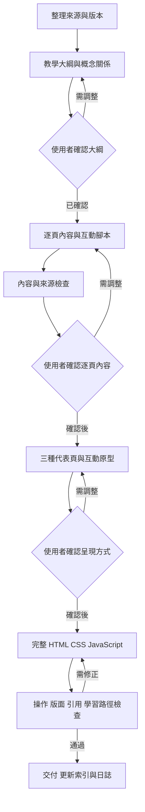

# 個人資料保護法：Graph 教學投影片逐頁規劃

- 日期：2026-11-20。
- 階段：教學大綱已確認；本文件為「逐頁內容與互動腳本」，待使用者確認。
- 讀者：第一次接觸個人資料保護法的學習者。
- 使用方式：依序學習為預設，也可透過知識地圖探索概念、案例與比較。
- 篇幅：22 個主線節點，加 2 個延伸節點，共 24 個節點。節點數是本輪內容提案，可再調整。
- 時間：主線約 30–40 分鐘，依案例討論時間調整；延伸閱讀不計入。
- 本輪交付：逐頁教學內容、圖解構想、互動腳本、來源對照與檢查標準。
- 尚未開始：Graph 原型、正式介面、完整投影片改製。現有 HTML 保留。

## 1. 工作流程與確認點

## 2. 教學目標與畫面原則

讀完主線後，學習者應能：

1. 用直接或間接識別的概念，判斷生活中的資料是否可能屬於個資。
2. 區分蒐集、處理、利用，並說明為何合法取得不代表可以任意使用。
3. 說明目的、必要範圍、合法依據、告知及同意各自的作用。
4. 找到適合情境的當事人權利，知道刪除請求仍有適用條件。
5. 依角色、目的、公開範圍及保存理由，拆解一個簡單案例。
6. 區分臺灣與 GDPR 的制度，不把通報時間或權利條件混用。

每頁以一個核心問題為主。預設畫面包含一句核心概念、一幅主要圖解、2–3 項短重點及一個互動。解析與來源可展開，影響答案的條件不能藏起來。名詞初次出現附英文對照與白話解釋。

雲朵角色沿用 `../../assets/marshmallow_clouds/`，用來引導提問與提醒。資料流、角色與法律判斷則以有標籤的圖解表達。不要以角色插圖取代概念說明。

## 3. 來源代碼與使用界線

| 代碼 | 來源 | 定位與用途 |
|---|---|---|
| W1 | [臺灣個資法 Wiki](../../wiki/frameworks/taiwan_pdpa.md) | 第 1–6 節，基本概念、權利、安全與責任 |
| W2 | [GDPR Wiki](../../wiki/frameworks/gdpr.md) | 第 2–6 節，適用、原則、權利與通報 |
| W3 | [臺灣與 GDPR 比較](../../wiki/syntheses/tw_pdpa_vs_gdpr.md) | 第 1–2 節，制度比較與易混淆處 |
| W4 | [CIA 三要素](../../wiki/concepts/cia_triad.md) | 第 2 節，安全維護與機密性、完整性、可用性 |
| L1 | [個資法與 GDPR 講義紀錄](../../raw/lectures/01_personal_data_protection_and_gdpr.md) | Slide 3：生命週期；4–5：演進；7–11：GDPR；12–16：對照 |
| L2 | [法條與課堂筆記](../../raw/lectures/02_taiwan_personal_data_protection_act_statute.md) | 以條號定位，屬課堂版本紀錄 |
| O1 | [官方條文與施行註記](https://law.pdpc.gov.tw/LawContent.aspx?id=FL010627) | 檢查法條內容、修法及施行狀態 |
| O2 | [官方條文整理](https://www.pdpc.gov.tw/News_Html/100/) | 對照已施行條文及 2023 年修法 |
| O3 | [歐盟官方義務說明](https://commission.europa.eu/law/law-topic/data-protection/information-business-and-organisations/obligations_en) | 外洩通報風險條件，第 33、34 條 |
| O4 | [GDPR 原文入口](https://eur-lex.europa.eu/eli/reg/2016/679/oj) | 第 3、17、20、22、33–34、37、39 條及第五章延伸查閱 |

引用格式：`[Lecture_PDA_GDPR, Slide 3]` 對應 L1；`[Law_TW_PDPA, Art. 5]` 對應 L2，涉及現行規範另附 O1/O2 的版本依據。來源代碼僅供規劃，正式畫面須有可開啟的來源名稱及條文／投影片定位。

既有講義未逐題記錄完整課堂問題。以下題目均為依 Wiki 與法條設計的「延伸情境題」，不宣稱為講師原題或法院結論。

前一輪已查核的版本差異保留：Wiki 的最高 50 萬元罰鍰、GDPR 適用條件及通報條件不直接照抄；2025 年修法須區分公布與施行。正式製作前，重新檢視受影響條文的官方施行註記，不因頁面更新日期推定全部條文生效。

## 4. 主線節點與逐頁互動腳本

### N00｜課程入口與學習地圖
- **教學目標**：知道如何開始，以及主線與自由探索的差別。
- **畫面文字**：「從一張報名表，認識資料使用的界線。」提示本課依序介紹資料、用途、權利、安全與生活應用。
- **圖解／操作**：顯示分群的概念地圖，預設突出「開始學習」。選取節點先顯示一句簡介，再決定進入。
- **回饋**：標示目前位置與建議起點，主題之間不設強制解鎖。
- **來源／連線**：L1 單元大綱；主線至 N01，所有節點均可回到 N00。

### N01｜為什麼需要保護個資？
- **教學目標**：理解資料便利與資料風險可以同時存在。
- **畫面文字**：「報名需要聯絡方式，使用範圍也需要界線。」重點：完成活動聯繫、避免不必要擴散、尊重本人權益。
- **圖解／操作**：活動報名表，點選姓名、電話與飲食需求，分別顯示合理用途與可能風險。
- **題目／回饋**：「主辦單位需要電話，代表能交給任何合作廠商嗎？」答案為不能直接推論，帶往用途與合法依據。
- **來源／連線**：W1 §1、L1 Slide 3、L2 第 1、5 條；主線 N02，相關 N07。

### N02｜什麼是個人資料？
- **教學目標**：理解個資以能否識別自然人為判斷重點。
- **畫面文字**：「能辨認出某個人的資料，就可能是個資。」自然人指個人；紙本資料也可能受保護。
- **圖解／操作**：點選「姓名搭配電話」「身分證字號」「無法連結任何人的整體統計」，選擇是否可能識別。
- **回饋**：前兩者可識別；統計案例明示假設無法透過其他資料回推個人，避免把所有統計當成已匿名。
- **來源／連線**：W1 §2、L2 第 2 條；主線 N03，相關 N04。

### N03｜拿掉姓名，還認得出來嗎？
- **教學目標**：分辨直接識別與間接識別。
- **畫面文字**：「資料拼在一起，可能重新指向某個人。」重點：其他資料、可用的對照、公開情境。
- **圖解／操作**：依序揭示「系所」「年齡」「唯一符合的人」，以文字與高亮顯示識別線索累積。
- **題目／回饋**：「把姓名改成學號就完成匿名化嗎？」未必，能對回本人就可能仍屬個資。用代碼代替姓名不等於無法識別。
- **來源／連線**：W1 §2、L2 第 2 條；主線 N04，應用 N16。

### N04｜一般個資與特種個資
- **教學目標**：知道第 6 條六類資料有更嚴格條件。
- **畫面文字**：「部分敏感資料需要更嚴格的使用依據。」六類依序顯示病歷、醫療、基因、性生活、健康檢查、犯罪前科。
- **圖解／操作**：姓名、電話、健康檢查表的按鈕分類。選取後顯示一般規則與特種規則的入口。
- **回饋**：姓名與電話仍受保護；特種個資原則禁止但有法定例外。若以同意為依據，另有書面及其他限制，不能把同意當成唯一例外。
- **來源／連線**：W1 §4、L2 第 6 條、O1；主線 N05，相關 N08、N10。

### N05｜誰是資料的本人？誰在使用？
- **教學目標**：認識當事人、公務機關、非公務機關與受託者。
- **畫面文字**：「角色不同，適用規則與責任也可能不同。」用學生、主辦單位與表單服務商說明。
- **圖解／操作**：角色關係圖，點選角色顯示「本人」「蒐集或使用資料」「受委託處理」及法律身分判斷提示。
- **回饋**：不能只憑名稱認定公務或非公務機關；一般個人也可能適用，單純個人／家庭活動另看第 51 條。
- **來源／連線**：W1 §2、L2 第 2、4、51 條；主線 N06，相關 N08、N14。

### N06｜資料生命週期
- **教學目標**：區分蒐集、處理、利用及保存／刪除。
- **畫面文字**：「填表、輸入名單、交付使用，各有需要檢查的環節。」依法律定義說明蒐集、處理、利用，並區分教學流程階段與法定用詞。
- **圖解／操作**：點選生命週期，觀看同一張報名表在填寫、名單整理、用途變更與活動結束時的狀態。
- **題目／回饋**：「把名單輸入試算表」屬處理；「取得報名表」屬蒐集。保存與刪除也可能落入法定處理行為。
- **來源／連線**：L1 Slide 3、W1 §2、L2 第 2 條；主線 N07，相關 N13、N14。

### N07｜特定目的與必要範圍
- **教學目標**：能指出表單中可能多收的欄位。
- **畫面文字**：「需要哪些資料，取決於要完成什麼事。」重點：具體目的、欄位必要性、使用範圍。
- **圖解／操作**：比較「一般線上講座」的兩張報名表，選出需補充理由的身分證字號與住家地址欄。
- **回饋**：題目明示不涉及身分驗證、寄送或保險等額外需求，因此這些欄位缺乏明確必要理由。不同活動不能一概而論。
- **來源／連線**：L2 第 5 條、W1 §6；主線 N08，應用 N16–N18。

### N08｜什麼情況可以取得資料？
- **教學目標**：理解同意只是合法事由之一。
- **畫面文字**：「先確認角色與資料類型，再找合法依據。」公務機關一般個資看第 15 條，非公務機關看第 19 條；特種個資先看第 6 條。
- **圖解／操作**：顯示簡化判斷流程。點選商店寄送訂單案例，顯示契約關係及必要範圍；點選健康資料提醒需轉入特種規則。
- **回饋**：有契約仍須符合該事由條件與適當安全措施，流程不是填一次就保證合法的工具。
- **來源／連線**：W1 §2、4，L2 第 6、15、19 條；主線 N09，相關 N04、N05。

### N09｜告知義務：填表前要知道什麼？
- **教學目標**：讀得懂基本個資告知事項。
- **畫面文字**：「先說清楚誰要用、怎麼用，以及本人能做什麼。」分組顯示目的與類別、使用範圍、權利及不提供的影響。
- **圖解／操作**：點選告知範例的標示，對照第 8 條六項事項。另有小入口介紹非本人提供資料時的第 9 條。
- **題目／回饋**：「只寫『同意提供個資』足夠嗎？」不足以說明適用的告知事項；免告知與有無合法依據也須分別判斷。
- **來源／連線**：L2 第 8–9 條、W1 §2；主線 N10，相關 N08。

### N10｜同意與新用途
- **教學目標**：區分原本用途、新用途，以及同意的範圍。
- **畫面文字**：「取得一次資料，不代表取得所有用途的許可。」重點：知情、適用依據、目的外利用。
- **圖解／操作**：把「活動通知」切換成「贊助商促銷」，圖上的接收者及用途一起改變。
- **題目／回饋**：「以前報名過，就能直接加入促銷群組嗎？」不能直接推論；須回查目的與第 16／20 條等依據。若依同意，檢查單獨意思表示與舉證，行銷另有拒絕規則。
- **來源／連線**：L2 第 7、16、20 條；主線 N11，相關 N07–N09。

### N11｜當事人的五項權利
- **教學目標**：能將需求對應到權利。
- **畫面文字**：「你可以知道資料如何保存，也可以依法要求更正、停止或刪除。」畫面逐項列出第 3 條五項權利，不合併到無法辨認。
- **圖解／操作**：選取「地址錯了」「想取得自己的資料」「希望停止使用」，顯示對應的更正、閱覽／複製、停止權利。
- **回饋**：法定權利不得預先拋棄或以特約限制；個別請求仍有適用條件。
- **來源／連線**：W1 §3、L2 第 3、10–11 條；主線 N12，相關 N13。

### N12｜提出請求後的時間線
- **教學目標**：理解准駁期限與延長上限。
- **畫面文字**：「收到請求後，機關須在期限內作成決定。」查閱／複製原則 15 日，必要延長最多 15 日；更正等第 11 條請求原則 30 日，必要延長最多 30 日。
- **圖解／操作**：切換請求類型，時間線顯示對應期限與書面延長原因。
- **回饋**：這是第 13 條准駁決定的期限，不能把最長延長期當成每件申請的預設期限，也不保證所有作業同時完成。
- **來源／連線**：L2 第 13 條、O1 第 13 條；主線 N13，相關 N11。

### N13｜資料什麼時候應該刪除？
- **教學目標**：理解保存理由與刪除權的條件。
- **畫面文字**：「保存要有理由，期限屆滿也要重新檢查。」比較目的消失、違法使用、仍有適用的法定或業務保存需要。
- **圖解／操作**：選擇「一般活動名單」或「須依法保存的特定紀錄」，顯示各自需檢查的條件。
- **回饋**：避免「一律立即刪除」或「可以永久保存」。有保存理由的部分，不能擴張為保留全部資料的理由。
- **來源／連線**：L2 第 5、11 條、W1 §3；主線 N14，應用 N18。

### N14｜安全維護與委外
- **教學目標**：理解合法蒐集之後仍須保護資料。
- **畫面文字**：「誰能看、能做什麼、何時刪除，都需要安排。」用名單、承辦人、雲端服務商說明。
- **圖解／操作**：對「公開連結」「共用帳號」「離職帳號未停用」選取改善方式，每題可重試。
- **回饋**：依風險採取適當權限、帳號管理及紀錄措施；委外仍須管理資料用途與安全要求。
- **來源／連線**：W4 §2、L1 Slide 3、L2 第 4、18、27 條與 O1 施行版本；主線 N15，相關 N05、N06。

### N15｜資料外洩後要通知誰？
- **教學目標**：分辨通知本人與通報機關。
- **畫面文字**：「先區分接收對象，再確認適用制度與期限。」將控制事故、確認影響與紀錄保全列為處理脈絡。
- **圖解／操作**：切換臺灣與 GDPR，分別顯示通知／通報對象與條件。臺灣版本提示常駐，不因切換隱藏。
- **回饋**：臺灣須依已施行法與行業規範判斷；GDPR 第 33 條有風險判斷，第 34 條高風險通知另有條件，不能把所有事故記成一律 72 小時通知本人。
- **來源／連線**：L1 Slide 12–16、L2 第 12 條、O1、O3；主線 N16，比較 N19，延伸 X01。

### N16｜校園案例：名單、榮譽榜與成績
- **教學目標**：用已學概念判斷公開資料的必要性。
- **畫面文字**：「教學需要資料，公開展示還要另外判斷。」使用虛構學生與成績。
- **圖解／操作**：選取「全網公開」「班級可見」「本人查詢」，比較接觸範圍。問題為「判斷前還需要哪些資訊？」可複選角色、目的、依據與可識別性。
- **回饋**：不直接宣稱所有榮譽榜違法。逐步回查用途、機關身分與公開必要性；遮一個字仍可能識別。
- **來源／連線**：L2 第 2、5、15–16、19–20 條；主線 N17，回查 N03、N05、N07、N10。

### N17｜社群案例：公開資料能任意轉用嗎？
- **教學目標**：區分資料真實、原本公開與再次利用的合法性。
- **畫面文字**：「看得到一筆資料，不代表能任意擴散。」以欠款爭議的借據公開為例。
- **圖解／操作**：選擇「完整公開借據」或「保留證據並循適用程序處理」，揭示目的、必要範圍及可能風險。朋友合照另作小型情境切換。
- **回饋**：判斷個資法適用與刑責須具體條件；單純個人／家庭活動另看第 51 條，其他人格權問題不因而消失。
- **來源／連線**：L2 第 5、19–20、41、51 條；主線 N18，回查 N05、N07、N10，延伸 X02。

### N18｜職場案例：履歷與離職資料
- **教學目標**：能依資料用途與保存理由分項判斷。
- **畫面文字**：「未錄取履歷與依法保存的紀錄，可能有不同處理方式。」
- **圖解／操作**：對兩種紀錄選擇「檢查用途與期限」「檢查法定保存依據」等處理步驟，點開理由。
- **回饋**：個資法未規定全部履歷統一保存一年；離職也不代表全部資料立即刪除。未核對專法的保存年限不作答題依據。
- **來源／連線**：L2 第 5、11、13 條；主線 N19，回查 N07、N11–N13。

### N19｜臺灣個資法與 GDPR
- **教學目標**：知道相同精神不代表相同適用條件。
- **畫面文字**：「目的、權利與安全都有規範，細節須分制度確認。」第一次完整介紹歐盟通用資料保護規則 (General Data Protection Regulation, GDPR)。
- **圖解／操作**：四個可切換的比較主題：適用範圍、權利、外洩通報、跨境傳輸。每次顯示一組短對照與一個例子。
- **回饋**：有歐盟訪客不足以單獨判定適用；可攜權為附條件取回及移轉資料；刪除權有例外；跨境傳輸先解釋為跨國境處理或利用。DPO 與更多細節放於延伸說明。
- **來源／連線**：L1 Slide 7–16、W2 §2–5、W3 §1–2；第 3、17、20、22、33–34、37 條與第五章。主線 N20，比較 N08、N11、N15。

### N20｜綜合練習：活動結束之後
- **教學目標**：把概念用於同一個完整情境。
- **畫面文字**：「社團要把活動名單交給贊助商，參加者同時提出刪除請求。」
- **圖解／操作**：依序作答三個決策：資料與欄位必要性、新行銷用途的依據、刪除請求的處理。每題皆有「資訊不足，需確認……」選項。
- **回饋**：分別連回 N04／N07、N08–N10、N11–N13。回答後保留題目狀態，回讀可返回原題。不以只有選對答案代表精通法律。
- **來源／連線**：L2 第 5–9、11、13、19–20 條；主線 N21，回讀線依錯誤概念指定。

### N21｜回顧與下一步
- **教學目標**：能說出判斷順序，找到自己需要補讀的概念。
- **畫面文字**：「先辨認資料與角色，再檢查目的、依據、權利與安全。」以少量句子回顧，不重貼所有法條。
- **圖解／操作**：回到完整地圖，突出已瀏覽與建議回讀節點，可選擇再做題、開啟來源或閱讀延伸。
- **回饋**：分開顯示「已瀏覽」與「練習結果」；不把點開頁面標為已理解。提供不記錄進度的閱讀方式。
- **來源／連線**：W1 全頁架構、L1 單元大綱；回到 N00，可前往 X01、X02。

## 5. 延伸節點

### X01｜法規版本與演進
- **目標／畫面**：區分講義版本、修正公布、實際施行；以時間線呈現，明示查核日期。
- **互動／解析**：選取某次修法，顯示官方沿革與受影響條文。回答「公布修正就能立即套用嗎？」時，解釋須看施行規定。
- **內容界線**：保留課堂歷史脈絡；不把未施行條文混入現行責任。2023／2025 的差異依 O1/O2 更新。
- **來源／連線**：L1 Slide 4–5、L2 修正日期、O1/O2；由 N15、N21 進入，返回實際進入點。

### X02｜民事、行政與刑事責任
- **目標／畫面**：區分賠償受害人、行政裁罰與符合要件時的犯罪責任。
- **互動／解析**：點選責任類型顯示目的及需確認的條件。問題「外洩就一定成立刑事犯罪嗎？」答案為不能直接認定。
- **內容界線**：不將第 28 條法定酌定金額當成所有個案賠償上限；不沿用最高 50 萬元作為現行概括罰鍰；金額若列出須附版本與適用條件。
- **來源／連線**：W1 §5、L2 第 28–29、41–42、48 條、O1/O2；由 N17、N21 進入，返回實際進入點。

## 6. Graph 連線與導覽規格

### 關係類型

| 關係 | 意義 | 操作 |
|---|---|---|
| 建議順序 | 課程的教學安排，不宣稱每條都是嚴格先備 | 上一頁／下一頁 |
| 回查概念 | 案例或題目用到的判斷依據 | 前往概念後，可返回原案例與作答位置 |
| 比較 | 同一問題在兩個制度中的對照 | 顯示比較理由及差異條件 |
| 延伸 | 可選的版本、責任細節 | 不阻擋主線完成 |
| 來源 | Wiki、講義與官方依據 | 展開定位與外部／本地連結 |

主線為 N00 至 N21 依序前進。完整地圖預設顯示主線及主題群，選取節點才突出其相關連線，避免一次顯示所有交叉線。連線須有文字標籤，不能只用顏色區分。

單頁顯示目前節點、所在主題、建議下一步，以及 2–3 個最相關節點；更多關聯放入可展開清單。視覺地圖另提供鍵盤可操作的文字節點清單。

地圖不設定強制解鎖。自由跳讀時提供先備提示，讀者仍可自行決定進入。深層連結以節點 ID 定位，重新整理後仍可回到原節點。瀏覽器返回與「返回案例」語意分開。

## 7. 互動共同規則

- 每個題目至少提供答案理由；錯誤選項說明錯在哪個概念，無法下結論時明示缺少的條件。
- 所有分類操作均可用按鈕完成，不以拖曳為唯一方式，不依賴滑鼠懸停。
- 支援鍵盤焦點、清楚的焦點外框、對話框 Esc 關閉、開關後焦點返回。
- 動畫僅用於關係突出或逐步揭示，尊重減少動態效果偏好，不使用持續晃動的背景。
- 閱讀進度與答題狀態預設留在當次頁面，不傳送到外部服務；是否提供跨次保存留待原型確認。
- 列印／閱讀模式按主線輸出，解析展開，延伸置後；避免把互動地圖當成唯一可閱讀內容。
- 來源欄每頁均可開啟，另有 Wiki 連結；公開發布與遠端服務不在本階段範圍。

## 8. 檢查結果與後續驗收

### 本輪內容檢查

- [x] 十個已確認主題均有對應節點。
- [x] 每個節點有教學目標、畫面重點、圖解／操作、解析方向與來源定位。
- [x] 情境題明確標為延伸，未冒稱講師原題。
- [x] 將版本與責任細節放於延伸；重要適用條件仍留在主線。
- [x] 題目回讀連到具體概念，並規劃返回原題。
- [x] 區分建議順序、概念回查、比較、延伸與來源，不把所有線都視為先備關係。
- [ ] 使用者確認逐頁內容與篇幅。

### 確認後的原型範圍

只先做三種代表畫面：N00 知識地圖、N07 概念與表單比較、N16 案例與回讀。用這三頁驗證「進入節點、返回地圖、案例回查、回到原題、答案回饋」的完整操作。

### 完整製作驗收

1. **教學**：首次出現的術語有說明；未在題目中要求尚未介紹的必要概念；案例不缺決定答案所需的條件。
2. **來源**：本地鏈結存在；每項法規主張能對到條號或投影片；使用官方註記區分修正與施行。
3. **Graph**：沒有不存在的節點或無法離開的節點；主線能走到回顧；返回案例保留作答。
4. **互動**：選項與解析一致；重試與重設狀態正確；快捷鍵不干擾表單與原生控制項。
5. **版面**：桌面、窄螢幕、放大文字與解析展開時沒有遮擋；圖像與標籤可讀；長內容可以正常捲動。
6. **無障礙與降級**：鍵盤可完成核心操作；地圖有文字替代；減少動畫與列印閱讀模式可用。

## 9. 檔案與階段管理

沿用現有 `slides/pdpa/`，本文件為規劃來源。確認原型時再安排 Graph 資料、版面與互動程式的分工，不重新建立專案。

本階段不修改 `index.html`、`styles.css`、`slides.js` 與既有內容資料。逐頁內容確認後才製作原型，原型確認後才全面改製。來源 `raw/` 保持不變，正式內容變更依專案規範更新索引並追加日誌。
