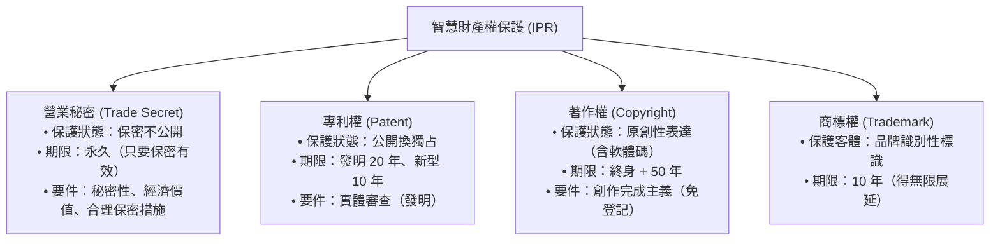

# CISSP Domain 1: 法律、法規與智慧財產權考點手冊

本手冊針對 CISSP Domain 1 (Security and Risk Management) 中最常考的法律體系、合規要求、隱私法案與智財權保護進行邏輯提煉與陷阱解析。

---

## 一、 法律三大體系與電腦犯罪特性 (Legal Systems & Cybercrime)

### 1. 三大法律體系
- **大陸法系 / 成文法系 (Civil Law)**：以台灣、德、法、日為代表，以法典條文為主要裁判依據。
- **普通法系 / 海洋法系 (Common Law)**：以美、英為代表，重視「判例法 (Case Law / Precedent)」，法官造法。
- **宗教法與習慣法 (Religious & Customary Law)**：如伊斯蘭教法 (Sharia Law)。

### 2. 電腦犯罪的法律要件與訴訟特性 (以台灣刑法為例)
- **告訴乃論 vs. 公訴罪 (非告訴乃論)**：
  - 一般入侵電腦 (第 358 條)、刪改電磁紀錄 (第 359 條)、干擾設備 (第 360 條) 為**告訴乃論**，告訴期間為**知悉犯人起 6 個月**！
  - 危害公務機關電腦 (第 361 條，加重 1/2) 或製作專供犯罪程式 (第 362 條) 為**公訴罪**。
- **電磁紀錄之法律地位**：刑法第 220 條確立電磁紀錄為「準文書」，偽造數位 Log 即該當偽造文書罪。

---

## 二、 隱私保護與國際法規對比 (Privacy Frameworks)

### 1. 經濟合作暨發展組織 (OECD) 隱私八大原則（隱私法規之共同母體）
1. 蒐集限制原則 (Collection Limitation)
2. 資料品質原則 (Data Quality)
3. 目的明確原則 (Purpose Specification)
4. 使用限制原則 (Use Limitation)
5. 安全防護原則 (Security Safeguards)
6. 開放原則 (Openness)
7. 個人參與原則 (Individual Participation)
8. 當責原則 (Accountability)

### 2. 歐盟 GDPR vs. 國內法規核心必背對比
- **域外管轄 (Extraterritoriality)**：GDPR 只要面向歐盟民眾提供服務即具管轄權。
- **72 小時外洩通報**：知悉個資侵害後 72 小時內通報主管機關 (DPA)；嚴重時通報當事人。
- **DPO 強制設置**：公務機關或大規模常態性監控/處理特種個資企業必須設置。
- **巨額罰金**：最高 2,000 萬歐元或 4% 全球營業額。
- 詳見完整矩陣：[[wiki/syntheses/tw_pdpa_vs_gdpr|我國個資法 vs. GDPR 深度對比矩陣]]。

---

## 三、 智慧財產權四大支柱 (Intellectual Property Protection)

在資安管理架構中，智財權屬於「資訊資產 (Information Assets)」保護核心：

### 必考記憶重點：
1. **演算法與原始碼該用專利還是營業秘密？**
   - 若容易被逆向工程 (Reverse Engineering) 破解 ➔ 申請**專利**保護（防禦獨立發明）。
   - 若深藏於雲端後端、對外不可見（如 Google PageRank、可口可樂配方） ➔ 採**營業秘密**（可永久保密）。
2. **合理保密措施之舉證**：
   - 審判中若公司未實施最小權限控管、未加密、未簽署 NDA，即使機密外洩亦**無法主張營業秘密法之刑事保護**！
3. **ISP 安全港條款 (Safe Harbor / Notice and Takedown)**：
   - 雲端服務商不知情且未直接獲利，在收到侵權通知後**立即下架**，得享民事免責。

---

## 四、 授權契約型態陷阱題

- **專屬授權 (Exclusive License)**：著作權人連自己都不能用，被授權人可行使類似專屬所有權人地位並獨立提告。
- **獨家授權 (Sole License)**：原著作權人自己可用，但不能再授權第三人。
- **普通授權 (Non-exclusive License)**：原權利人可任意授權多家廠商使用。

---

## 五、 出處依據與關聯鏈結
- 來源依據：`[Lecture_PDA_GDPR]`, `[Lecture_Criminal_Code]`, `[Lecture_IPR]`
- 相關法規：[[wiki/frameworks/taiwan_pdpa|我國個資法]]、[[wiki/frameworks/gdpr|GDPR]]、[[wiki/frameworks/taiwan_cybercrime_law|刑法電腦犯罪]]、[[wiki/frameworks/trade_secret_act|營業秘密法]]
- 橫向評比：[[wiki/syntheses/tw_pdpa_vs_gdpr|個資法 vs GDPR]]、[[wiki/syntheses/ipr_trade_secret_vs_patent|智財權評比]]
