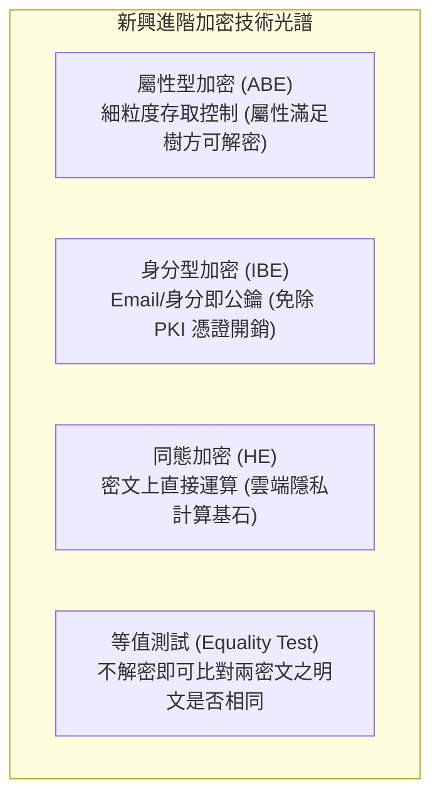

# 進階密碼機制、量子計算威脅與後量子密碼學

## 1. 核心概念與技術演進
隨著雲端計算、大數據共享與量子計算技術的飛躍發展，傳統以 PKI 憑證為中心、基於 RSA/ECC 的密碼學架構正面臨兩大挑戰：
1. **細粒度與隱私運算需求**：傳統加密僅能達成「全有或全無」的解密，催生了**屬性型加密 (ABE)**、**身分型加密 (IBE)**、**同態加密 (HE)** 與**等值測試 (Equality Test)**。
2. **量子計算對現代密碼學的毀滅性打擊**：促使全球標準機構（如美國 NIST）推動**後量子密碼學 (Post-Quantum Cryptography, PQC)** 與物理層的**量子金鑰分發 (QKD)**。

---

## 2. 新興進階加密機制 (Advanced Cryptographic Primitives)

### 2.1 屬性型加密 (Attribute-Based Encryption, ABE) [Lecture_09, Slide 40-41]
- **機制本質**：將存取控制策略 (Access Policy) 與加密機制直接融合。
- **兩大分支**：
  - **金鑰策略 ABE (KP-ABE)**：密文標註屬性集合，私鑰對應存取樹策略。
  - **密文策略 ABE (CP-ABE)**：私鑰標註使用者屬性集合，加密者在密文中指定存取樹（如「部門=研發 AND 職等 $\ge$ 經理」）。
- **優勢**：實現密文層級的「細粒度存取控制 (Fine-grained Access Control)」，資料所有者可完全掌控誰有權解密。

### 2.2 身分型加密 (Identity-Based Encryption, IBE) [Lecture_09, Slide 42]
- **機制本質**：由 Shamir 提出，使用者任意公開的身分標識（如 Email 帳號、身分證字號、IP 位址）即為其 Public Key。
- **金鑰生成中心 (KGC)**：發送者利用 KGC 之公開參數與接收者身分字串直接加密；接收者向 KGC 認證身分後取得對應的 Private Key。
- **優勢**：徹底省去傳統 PKI 體系中龐大複雜的數位憑證申請、驗證、傳輸與撤銷清單 (CRL/OCSP) 管理成本。

### 2.3 同態加密 (Homomorphic Encryption, HE) [Lecture_09, Slide 43]
- **數學公理**：對密文進行代數運算，解密後的結果等價於直接在明文上進行運算：
  $$\text{Dec}_{sk}(\text{Enc}_{pk}(m_1) \odot \text{Enc}_{pk}(m_2)) = m_1 \oplus m_2$$
- **分類階梯**：
  - **部分同態加密 (PHE)**：僅支援單一運算（如加法同態 Paillier、乘法同態 RSA）。
  - **全同態加密 (FHE)**：由 Gentry 於 2009 年突破，可同時支援任意次數的加法與乘法電路運算（支援 Turing-complete 任意運算）。
- **應用場景**：委外安全雲端計算（金融徵信、醫療隱私基因比對），雲端代工運算過程中完全無法得知原始明文。

### 2.4 等值測試 (Equality Test) [Lecture_09, Slide 44]
- **定義**：在**完全不解密密文**的情況下，任何授權的第三方伺服器均可比對兩筆密文 $C_1 = \text{Enc}(m_1)$ 與 $C_2 = \text{Enc}(m_2)$ 是否滿足 $m_1 = m_2$。
- **應用**：加密雲端資料庫去重複 (Deduplication)、加密電子郵件分類與關鍵字搜尋。

---

## 3. 量子計算對現代密碼學的衝擊 (Quantum Threats)

量子電腦利用量子疊加態 (Superposition) 與量子糾纏 (Entanglement) 實現特定演算法之超多項式加速 [Lecture_09, Slide 47]：

| 密碼演算法分類 | 代表性技術 | 量子攻擊演算法 | 衝擊程度 | 應對處置方案 |
| :--- | :--- | :--- | :---: | :--- |
| **公鑰加密 / 金鑰交換** | RSA, DH, ECDH, ElGamal | **Shor's Algorithm** (秀爾演算法，多項式時間求解質因數與離散對數) | **徹底毀滅 (Broken)** | 全面遷移至**後量子密碼學 (PQC)** |
| **數位簽章** | RSA, DSA, ECDSA, Ed25519 | **Shor's Algorithm** | **徹底毀滅 (Broken)** | 遷移至晶格或雜湊簽章 (ML-DSA, SLH-DSA) |
| **對稱式區塊加密** | AES-128, AES-256 | **Grover's Algorithm** (葛羅佛演算法，提供平方根 $\mathcal{O}(\sqrt{N})$ 加速) | **輕微影響 (Mildly Affected)** | **將金鑰長度加倍**（如使用 AES-256 可提供 128-bit 抗量子安全） |
| **密碼學雜湊函數** | SHA-256, SHA-3 | **Grover / Brassard-Høyer-Tapp** (碰撞搜尋加速至 $\mathcal{O}(N^{1/3})$) | **輕微影響 (Mildly Affected)** | **增大輸出長度**（採用 SHA-384、SHA-512） |

---

## 4. 後量子密碼學標準體系 (NIST PQC Standardization)

後量子密碼 (PQC) 指的是**運行於現有古典電腦與網路架構**上、但能抵抗未來大規模量子電腦攻擊之數學演算法 [Lecture_09, Slide 48]：

### 4.1 五大 PQC 演算法數學分支
1. **晶格基礎密碼 (Lattice-Based)**：
   - 數學難題：最短向量問題 (SVP)、最接近向量問題 (CVP)、容錯學習 (LWE / Ring-LWE)。
   - 特點：效能、金鑰大小與密文長度平衡最佳，為 NIST 標準主流（如 ML-KEM / Kyber, ML-DSA / Dilithium）。
2. **編碼基礎密碼 (Code-Based)**：
   - 數學難題：隨機線性碼通用解碼難題 (General Linear Code Decoding, 如 McEliece 系統)。
   - 特點：運算極快、密文小，但**公鑰體積極大**（數百 KB 至數 MB）。
3. **同源基礎密碼 (Isogeny-Based)**：
   - 數學難題：超奇異橢圓曲線之間的同源映射計算。
   - 特點：公鑰極小，但運算速度慢（註：SIKE 已於 2022 年被古典演算法攻破）。
4. **多變量多項式密碼 (Multivariate-Based)**：
   - 數學難題：求解有限體上非線性多變量多項式方程組 (MQ Problem)。
   - 特點：適合用於極短數位簽章。
5. **雜湊基礎密碼 (Hash-Based)**：
   - 數學難題：純粹依賴密碼學雜湊函數之單向性與抗碰撞性（Merkle 樹簽章）。
   - 特點：安全理論最堅固、經受最長久考驗，但簽章長度較大（如 SLH-DSA / SPHINCS+）。

---

## 5. 量子金鑰分發 (Quantum Key Distribution, QKD)

- **核心本質**：QKD 不是密碼學演算法，而是一種**利用量子物理學特性（光子偏振與測不準原理）之硬體傳輸通道**。
- **BB84 協議**（Bennett & Brassard 於 1984 年提出）：
  - 雙方透過單光子脈衝在四種偏振態（水平/垂直、$+45^\circ/-45^\circ$）下隨機選擇基底傳輸。
  - **抗竊聽公理**：海森堡測不準原理與量子不可複製定理 (No-cloning Theorem) 確保任何中間人竊聽必將不可逆地擾動量子態，雙方比對測試位元時即可立刻察覺竊聽並捨棄金鑰。
- **QKD vs. PQC 對比**：
  - QKD 需要專屬昂貴光纖硬體設施，無法穿越一般網際網路路由器；PQC 則可無縫部署於現有網際網路協定（TLS 1.3、IPsec）。

---

## 6. 證照高頻考點與易混淆陷阱 (Exam Focus)

- **考點 1：量子威脅之非對稱 vs. 對稱陷阱**
  - **陷阱**：考試若問「量子電腦出現後，AES 是否完全失效？」$\rightarrow$ **錯誤**！對稱密碼僅受 Grover 演算法平方根影響，AES-256 依然具備 128 位元抗量子強度，完全無需廢棄。
  - 真正被徹底破壞的是基於 IFP/DL/ECC 的公鑰體系（RSA, ECDSA）。
- **考點 2：同態加密支援的運算能力**
  - Paillier 僅支援加法同態；RSA 僅支援乘法同態；只有 Gentry 提出的全同態加密 (FHE) 才能同時支援加法與乘法，達成任意運算。
- **考點 3：PQC 與 QKD 的架構差異**
  - PQC 是**軟體演算法**（古典硬體可跑，抗量子算力）；QKD 是**物理硬體設備**（光纖通訊，防竊聽金鑰分發）。

---

## 7. 出處依據與關聯鏈結
- **來源依據**：[Lecture_09_Crypto, Slide 40-44, 47-49]
- **關聯頁面**：
  - [[wiki/models/cryptographic_hard_problems]]
  - [[wiki/syntheses/symmetric_vs_asymmetric_cryptography]]
  - [[wiki/cert_prep/cissp_domain_3_cryptography]]
