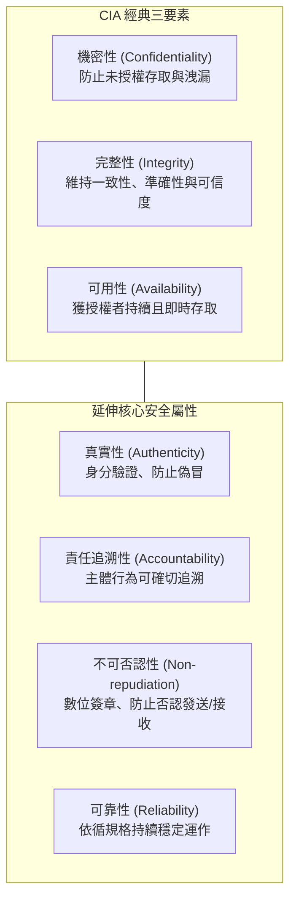

# CIA 三要素與資訊安全核心屬性

## 1. 核心概念與理論基石
資訊安全 (Information Security) 的本質在於防範各類威脅利用系統脆弱性，以保障資訊在儲存 (At Rest)、傳輸 (In Transit) 與處理 (In Process) 過程中的安全屬性。經典的防護核心建立在 **CIA 三要素 (CIA Triad)** 之上，並延伸至網路安全體系的四大支柱屬性。

---

## 2. CIA 三大維度定義與實作控制

### 2.1 機密性 (Confidentiality)
- **學術定義**：To prevent sensitive information from unauthorized access attempts（防止敏感資訊遭受未經授權之存取嘗試）[Lecture_09, Slide 5]。
- **威脅樣態**：竊聽 (Eavesdropping)、網路側錄 (Snooping)、未經授權存取、社工釣魚。
- **代表性防護控制**：
  - 對稱式與非對稱式加密 (AES, RSA)。
  - 存取控制清單 (ACL) 與最小權限原則 (PoLP)。
  - 敏感資料屏蔽與去識別化。

### 2.2 完整性 (Integrity)
- **學術定義**：To maintain the consistency, accuracy and trustworthiness of data（維護資料之一致性、正確性與可信賴度）[Lecture_09, Slide 5]。
- **威脅樣態**：未授權竄改 (Unauthorized Modification)、中間人攻擊 (MitM)、惡意重送 (Replay Attack)、軟體邏輯後門。
- **代表性防護控制**：
  - 密碼學雜湊函數 (SHA-256, SHA-3)。
  - 訊息鑑別碼 (MAC / HMAC)。
  - 數位簽章 (Digital Signatures)。
  - 嚴格變更管理與軟體版本控管。

### 2.3 可用性 (Availability)
- **學術定義**：To keep information consistently and readily accessible for authorized parties（確保獲授權主體得持續且隨時存取所需資訊）[Lecture_09, Slide 5]。
- **威脅樣態**：阻斷服務攻擊 (DoS / DDoS)、設備故障、勒索軟體加密、自然災害與電力中斷。
- **代表性防護控制**：
  - 備份與災難復原演練 (RTO / RPO)。
  - 高可用性叢集 (HA Cluster)、負載平衡 (Load Balancing)。
  - 抗 DDoS 防禦設備與網路頻寬備援。

---

## 3. 延伸四大核心安全屬性

1. **真實性 (Authenticity / Identity Verification)**：
   - 確保通訊實體、交易訊息或系統來源為其所宣稱之真實對象，排除偽造 (Forgery) 與偽冒 (Impersonation)。
   - 機制：多因素身分驗證 (MFA)、公開金鑰基礎建設憑證 (PKI X.509)。
2. **責任追溯性 (Accountability)**：
   - 系統內的任何事件均可明確溯源至特定單一主體（禁止共用帳號）。
   - 機制：安全稽核日誌 (Audit Logs)、身分識別碼 (UID)、NTP 時戳同步。
3. **不可否認性 (Non-repudiation)**：
   - 證明訊息之發送或接收事實，使行為人無法抵賴否認。
   - 機制：**非對稱式數位簽章 (Digital Signature)**（對稱式加密無法達成）。
4. **可靠性 (Reliability)**：
   - 系統依據預期規格持續穩定執行預定任務，無非預期之後果與崩潰。

---

## 4. 證照高頻考點與易混淆陷阱 (Exam Focus)

- **考點 1：不可否認性之必要充分條件**
  - **陷阱**：使用對稱式加密（如單純 AES 密文）**不能提供不可否認性**，因為發送方與接收方共享相同密鑰，接收方隨時可偽造同樣的密文！只有使用發送者 Private Key 簽署之「非對稱數位簽章」，方能具備不可否認性。
- **考點 2：完整性 vs. 機密性之對立陷阱**
  - 加密僅保護機密性，**加密本身不等於提供完整性保護**（攻擊者仍可在傳輸途中隨機竄改密文字元，造成解密出垃圾資料）。完整性必須搭配雜湊 (Hash) 或 MAC。
- **考點 3：停機可用性計算公式**
  - 核心系統可用性 $99.99\%$ (Four Nines)，一年最大容許非計畫性中斷時間：
    $$365 \times 24 \times 60 \times (1 - 0.9999) = 52.56 \text{ 分鐘/年}$$

---

## 5. 出處依據與關聯鏈結
- **來源依據**：[Lecture_09_Crypto, Slide 5-6]
- **關聯頁面**：
  - [[wiki/models/cryptographic_hard_problems]]
  - [[wiki/syntheses/symmetric_vs_asymmetric_cryptography]]
  - [[wiki/frameworks/taiwan_cybersecurity_responsibility_tiers]]
  - [[wiki/cert_prep/cissp_governance_and_incident_mapping]]
