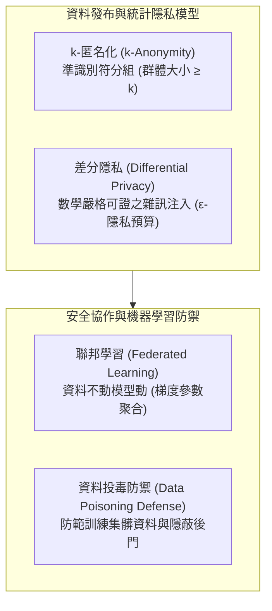

# 隱私強化技術與機器學習安全 (Privacy-Enhancing Technologies & ML Security)

## 1. 核心概念與理論背景
在個資隱私法規（如台灣 [[wiki/frameworks/taiwan_pdpa|個人資料保護法]] 與歐盟 [[wiki/frameworks/gdpr|GDPR]]）對「個人資料可識別性」要求日益嚴格的背景下，傳統單純刪除姓名身分證號之遮蔽方式已無法防範**連結攻擊 (Linking Attack)**。因此，**隱私強化技術 (Privacy-Enhancing Technologies, PETs)** 與分散式機器學習防禦成為學術研究與合規實務的核心前沿。

---

## 2. 匿名化與隱私防護核心模型

### 2.1 $k$-匿名化模型 ($k$-Anonymity) [Lecture_09, Slide 46]
- **形式化定義**：
  若發布的資料集中，每一筆個人記錄所包含的準識別符 (Quasi-identifiers, QID，如年齡、性別、郵遞區號) 屬性組合，在該資料集中**無法與至少另外 $(k - 1)$ 位獨立個體區分開來**，則稱該資料集滿足 $k$-匿名性。
  $$\forall QID, \quad |\text{Equivalence Class}(QID)| \ge k$$
- **實作手法**：
  - **泛化 (Generalization)**：將精確數值轉為區間（如年齡 24 歲 $\rightarrow$ [20-29] 歲；郵遞區號 10041 $\rightarrow$ 100**）。
  - **抑制 (Suppression)**：將過於獨特無法分組的極端值直接刪除或以 `*` 隱藏。
- **經典理論缺陷與演進**：
  - **同質性攻擊 (Homogeneity Attack)**：若同一等價類中所有個體的敏感屬性完全相同（如 5 個人皆得肺炎），攻擊者仍可精確推論其疾病。$\rightarrow$ 演化出 **$l$-多樣性 ($l$-Diversity)**。
  - **背景知識攻擊 (Background Knowledge Attack)**：若敏感屬性分佈過於偏斜。$\rightarrow$ 演化出 **$t$-貼近性 ($t$-Closeness)**。

### 2.2 差分隱私 (Differential Privacy, DP) [Lecture_09, Slide 47]
- **形式化公理 ($\epsilon$-Differential Privacy)**：
  設隨機化演算法 $\mathcal{M}$，對任意相差僅一筆個資記錄的鄰近資料集 $D_1, D_2$（即 $|D_1 \oplus D_2| = 1$），以及任意可能的輸出子集 $S$：
  $$\Pr[\mathcal{M}(D_1) \in S] \le e^{\epsilon} \times \Pr[\mathcal{M}(D_2) \in S]$$
- **參數意涵**：
  - **$\epsilon$ (隱私預算 / Privacy Loss Budget)**：$\epsilon$ 越小，隱私保護程度越高（輸出分佈幾乎無差別，但資料可用性與準確度下降）；$\epsilon$ 越大，資料準確度越高但隱私風險增加。
- **雜訊注入機制**：
  - **拉普拉斯機制 (Laplace Mechanism)**：針對數值型查詢加入符合 $\text{Lap}(\Delta f / \epsilon)$ 之雜訊（其中 $\Delta f$ 為全域敏感度 Global Sensitivity）。
  - **指數機制 (Exponential Mechanism)**：針對非數值型類別查詢之採樣。
- **核心優勢**：提供強大的**數學可證明隱私保證 (Information-Theoretic Privacy)**，完全免疫任何輔助資訊或背景知識攻擊。

---

## 3. 分散式聯邦學習與對抗安全 (Federated Learning & ML Security)

### 3.1 聯邦學習 (Federated Learning, FL) [Lecture_09, Slide 48]
- **核心哲學**：**「資料不動模型動，數據可用不可見 (Bring code to data, not data to code)」**。
- **運作生命週期**：
  1. 協調伺服器向參與客戶端廣播全局初始模型權重 $W_t$。
  2. 各端點客戶端（手機、醫院、銀行）使用本地敏感資料訓練模型，計算梯度更新 $\Delta W_i$。
  3. 各客戶端僅將模型權重或梯度向量上傳至聚合伺服器。
  4. 聚合伺服器透過 **聯邦平均演算法 (FedAvg)** 進行加權平均，更新全局模型：
     $$W_{t+1} = W_t + \sum_{i=1}^K \frac{n_i}{n} \Delta W_i$$
- **安全風險**：若傳輸的梯度明文被攔截，攻擊者可透過**深度逆向洩漏 (Deep Leakage from Gradients)** 重建原始影像或文本！對策為結合**同態加密 (HE)** 或**安全多方計算 (SMPC)** 實施安全聚合 (Secure Aggregation)。

### 3.2 資料投毒攻擊與防護 (Data Poisoning) [Lecture_09, Slide 49]
- **攻擊模式分類**：
  1. **可用性投毒 (Availability / DOS Poisoning)**：污染訓練資料破壞整體決策邊界，導致模型全盤準確率大幅下降。
  2. **針對性/後門投毒 (Targeted / Backdoor Poisoning)**：在特定樣本中植入隱蔽觸發特徵（如相片右下角小白點），在一般情況下模型推論完全正常，但只要出現觸發特徵便強制分類至攻擊者指定的目標類別。
- **防禦手段**：
  - 訓練資料異常值檢測 (Anomaly & Outlier Detection)。
  - 差分隱私訓練 (DP-SGD，透過剪裁梯度與注入高斯雜訊消除單一惡意樣本影響)。
  - 魯棒聚合演算法（如 Krum, Trimmed Mean，剔除偏離均值過遠之惡意更新）。

---

## 4. 證照高頻考點與易混淆陷阱 (Exam Focus)

- **考點 1：去識別化 vs. 匿名化之法律界線**
  - **去識別化 (Pseudonymization / De-identification)**：代換假名或加密，若持有金鑰或對照表仍可還原者，在法規上**依然屬於個人資料**，受個資法與 GDPR 管轄！
  - **匿名化 (Anonymization)**：經處理後以目前科學技術完全無法直接或間接識別個人者，**方可排除於個資法適用之外**。
- **考點 2：$k$-匿名化的 $k$ 代表什麼？**
  - 每個等價類中包含的獨立個體數量**至少為 $k$ 個人**（使任意單一個體被識別的機率不超過 $1/k$）。
- **考點 3：差分隱私中 $\epsilon$ 的取值效果**
  - $\epsilon \rightarrow 0$：隱私最強，雜訊無限大，實用價值趨近於零；
  - 實務常見取值範圍在 $0.1 \le \epsilon \le 5$ 之間。

---

## 5. 出處依據與關聯鏈結
- **來源依據**：[Lecture_09_Crypto, Slide 45-49]
- **關聯頁面**：
  - [[wiki/frameworks/taiwan_pdpa]]
  - [[wiki/frameworks/gdpr]]
  - [[wiki/concepts/advanced_encryption_and_pqc]]
  - [[wiki/cert_prep/cissp_domain_1_legal_regulations]]
