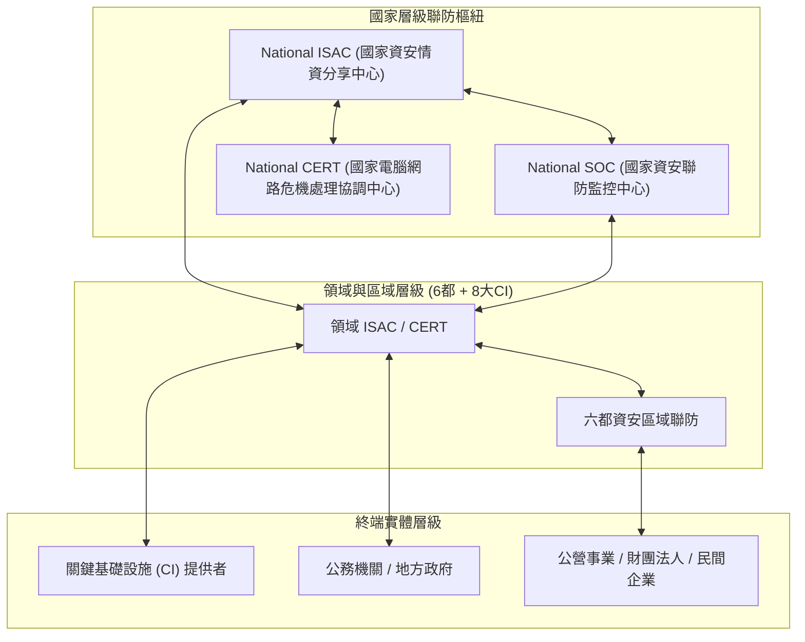

# 資通安全情資分享與交通號誌協定 (Threat Intelligence Sharing & TLP)

## 1. 核心概念與法源架構
- **法規依據**：《資通安全管理法》第 8 條及《資通安全情資分享辦法》。
- **情資定義**（情資分享辦法第 2 條）：包括惡意偵察情蒐活動、安全漏洞、利用漏洞之方法、惡意程式資訊、資安事件實際損害或負面影響、預防因應措施、以及其他技術性資訊。
- **治理目標**：打破資安孤島，建立「早期預警 (Early Warning)」、「持續監控 (Continuous Monitoring)」與「緊急應變 (Incident Handling)」之全國跨領域聯防體系。

---

## 2. 國家資安聯防體系架構 (Three National Pillars)



1. **N-ISAC (National ISAC)**：國家級情資整合核心，負責跨領域情資收容、分析、加值、去識別化後廣播給各領域 ISAC。
2. **N-SOC (National SOC)**：國家級聯防監控核心，收容監控事件單、分析入侵指標 (IoC) 與攻擊指標 (IoA)、提供關聯分析與回饋建議。
3. **N-CERT (National CERT)**：國家級應變協調樞紐，統籌國內外漏洞通報與跨國危機協處（對接 APCERT、FIRST 等國際組織）。

---

## 3. 情資分享等級：交通號誌協定 (Traffic Light Protocol, TLP)

依據 N-ISAC 與國際通行的 TLP 標準，情資依機敏性由高至低劃分為四種色彩等級：

| 分享等級 | 英文標示 | 機敏屬性 | 授權擴散範圍與分享原則 |
| :---: | :---: | :--- | :--- |
| **RED (紅燈)** | Non-shareable / Restricted | **極高度機密 / 私密情資** (Private) | • 情資內容絕不應使第三方知悉。<br>• **嚴禁進行自動化系統廣播**。<br>• 僅限指名的受限對象於加密管道或面對面交流。 |
| **AMBER (黃燈)** | Limited Disclosure | **限制組織/成員知悉** (Need-to-Know) | • 僅限接收組織內部相關處理人員或授權人員知悉。<br>• **不可公開於外部公眾網站**。<br>• 轉載或對外引用必須取得原始資料來源單位之書面同意。 |
| **GREEN (綠燈)** | Community Disclosure | **群組會員知悉** (Community-wide) | • 資訊不可對社會大眾公開。<br>• 可提供給所有 N-ISAC 會員或特定產業同儕。<br>• 轉載使用需標示來源出處。 |
| **WHITE (白燈)** | Public Disclosure | **公開資訊** (Public) | • 內容為可公開揭露之資訊。<br>• 傳遞與分享不限制任何對象，可直接張貼於公開網站。 |

---

## 4. 情資生命週期四大處理階段 (Threat Intel Lifecycle)

```text
[情資收容] ──> [情資彙整] ──> [情資加值] ──> [情資分析與處置]
```

1. **情資收容 (Ingestion)**：識別來源可靠度、驗證數位簽章/加密傳輸、萃取情資內容並確認時效性。
2. **情資彙整 (Aggregation)**：依威脅類型、TLP 分享等級、受影響平台、攻擊手法（如 MITRE ATT&CK TTPs）分類建檔。
3. **情資加值 (Enrichment)**：結合機關內部網路拓撲、資產清冊與業務重要性，賦予實務脈絡。
4. **情資分析與處置 (Analysis & Action)**：
   - 進行行為模式比對與關聯分析。
   - 產出預防措施（如防火牆黑名單封鎖、IDS 規則更新、端點 EDR 阻斷）。
   - **向外分享前必須落實個資與機敏資料「去識別化 (De-identification)」**。

---

## 5. 證照高頻考點與易混淆陷阱 (Exam Focus)

- **考點 1：TLP RED 能否進行自動化 API 分享？**
  - **陷阱**：**絕對不行**！TLP RED 屬於高度機密，禁止系統自動推播（如 TAXII API 廣播）。
- **考點 2：情資分享前之法定限制**
  - 依情資分享辦法第 4 條，涉及營業秘密、公務機密或個人資料者，**原則上不得分享**；若為公益必要或防禦所需，必須先進行**資料遮蔽、刪除或去識別化**後，方得就其餘技術部分分享。
- **考點 3：IoC vs. IoA 之辨析**
  - **IoC (Indicator of Compromise，入侵指標)**：事後證據，如惡意檔案 Hash、惡意 IP、釣魚 URL。
  - **IoA (Indicator of Attack，攻擊指標)**：攻擊發生中之行為特徵，專注於攻擊手法 (TTPs) 與異常行為意圖。
- **考點 4：CISSP 領域對照**
  - 對應 CISSP Domain 7 (Security Operations) 之 **威脅情資 (Threat Intelligence, CTI)** 與 **ISO 27001:2022 A.5.7 (Threat intelligence)** 控制項。

---

## 6. 出處依據與關聯鏈結
- **法規依據**：《資通安全管理法》第 8 條、《資通安全情資分享辦法》第 2 條至第 10 條；
- **講義依據**：[Lecture_08_ThreatIntel, Slide 3-24]
- **關聯頁面**：
  - [[wiki/frameworks/taiwan_cybersecurity_management_act]]
  - [[wiki/frameworks/taiwan_cybersecurity_responsibility_tiers]]
  - [[wiki/concepts/incident_response_and_reporting]]
  - [[wiki/cert_prep/cissp_domain_1_legal_regulations]]
