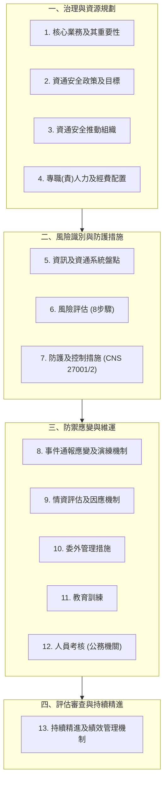

# 資通安全維護計畫與風險評鑑指引

## 1. 核心概念與法源依據
- **法規依據**：《資通安全管理法》第 10 條、第 16 條、第 17 條及《資通安全管理法施行細則》第 6 條、第 7 條。
- **核心定位**：資通安全維護計畫 (Cybersecurity Maintenance Plan, CSMP) 是機關推動資安治理之「基本大法」與行動綱領，貫徹 PDCA（規劃、執行、查核、行動）持續改善循環。
- **適用範圍**：涵蓋機關「全機關」業務，包括駐外單位及派駐人員設備（[Lecture_07, Slide 54]）。

---

## 2. 維護計畫 13 大法定項目 (細則第 6 條)

1. **核心業務及其重要性**：依組織法規、主要服務或 CI 業務認定，並針對差勤、郵件等非核心業務設定最大可容忍中斷時間 (MTD)。
2. **資通安全政策及目標**：由資通安全長 (CISO) 核定，明訂量化指標（核心系統可用性 $\ge 99.99\%$、郵件釣魚開啟率 $<5\%$、點閱率 $<2\%$）與質化指標。
3. **資通安全推動組織**：CISO 領導下設「策略規劃組」、「資安防護組」、「績效管理組」。
4. **專職(責)人力及經費配置**：依責任等級編制 1~4 人，每年檢討資安預算佔比。
5. **資訊及資通系統盤點**：建立資產清冊（資訊、軟體、實體、支援服務 4 大類）。
6. **風險評估**：每年執行詳細風險評鑑。
7. **防護及控制措施**：對齊 CNS 27001 / CNS 27002 標準。
8. **事件通報應變及演練機制**：法定通報應變與定期演練。
9. **情資評估及因應機制**：外部情資接收、過濾、分析與防護。
10. **委外管理措施**：選任評估、契約規範、客製化開發第三方檢測。
11. **教育訓練**：專責人員 12hr/年，一般人員及主管 3hr/年。
12. **人員考核**：公務機關落實資安獎懲。
13. **持續精進及績效管理機制**：內部稽核（每年至少 1 次）與管理審查會議（每年至少 1 次）。

---

## 3. 詳細風險評鑑方法 (Detailed Risk Assessment)

### 3.1 八大評鑑步驟
1. **資產識別 (Asset Identification)**：盤點各業務流程之資訊資產。
2. **威脅與脆弱性識別 (Threat & Vulnerability)**：鑑別威脅利用弱點對 CIA 之潛在衝擊。
3. **現有控制措施識別 (Existing Controls)**：檢視現存管理與技術防護之有效性。
4. **後果識別 (Consequence Identification)**：識別喪失機密性、完整性或可用性之後果。
5. **後果評鑑 (Consequence Assessment / Asset Valuation)**：評估營運衝擊並決定資產價值。
6. **事件可能性評鑑 (Likelihood Assessment)**：綜合評定威脅等級與脆弱性等級。
7. **決定風險等級 (Risk Level Determination)**：計算綜合風險值並分級。
8. **決定風險可接受水準 (Risk Acceptance Level)**：判定是否落入可接受區間。

### 3.2 數學計算模型公理 (Calculations & Thresholds)
- **資訊資產價值 (Asset Value)**：
  $$\text{資產價值 (Asset Value)} = \max(C_{\text{鑑價}}, I_{\text{鑑價}}, A_{\text{鑑價}})$$
  *(採用 1~3 分制：普=1, 中=2, 高=3)*
- **資訊資產風險值 (Risk Value)**：
  $$\text{Risk Value} = \text{資產價值} \times \text{威脅發生可能性} \times \text{脆弱性利用難易度}$$
  *(取值區間：$1 \times 1 \times 1 = 1$ 至 $3 \times 3 \times 3 = 27$)*
- **風險等級劃分**：
  - **普 (Low Risk)**：$1 \sim 6$
  - **中 (Medium Risk)**：$7 \sim 12$
  - **高 (High Risk)**：$13 \sim 27$
- **風險接受門檻**：
  $$\text{風險值} < 15 \implies \text{可接受風險 (Acceptable Risk)}$$
  $$\text{風險值} \ge 15 \implies \text{不可接受風險，必須優先實施風險處理方案}$$

---

## 4. 四大風險處理策略 (Risk Treatment Strategies)
1. **風險修改 (Risk Mitigation / Reduction)**：採取管理面或技術面控制措施（如增設 WAF、導入 MFA、修補漏洞），降低脆弱性或威脅影響。
2. **風險保留 (Risk Retention / Acceptance)**：風險值低於 15，或殘餘風險處理成本高於資產價值時，經管理審查會議同意由管理層簽署承受。
3. **風險避免 (Risk Avoidance)**：放棄或改變特定作業流程、下線高風險資通系統，從源頭根除風險。
4. **風險分擔 (Risk Sharing / Transfer)**：透過商業保險、委外服務契約或雲端 SLA，將風險衝擊轉由第三方共擔。

---

## 5. 證照高頻考點與易混淆陷阱 (Exam Focus)

- **考點 1：Max-rule 資產鑑價公理**
  - 在我國資安評鑑與 CISSP/NIST 標準中，資產價值取 CIA 三項評鑑中之**最高值（Max）**，而非平均值！只要系統極度需要可用性（如水庫閘門控制，A=3），即便無機密性（C=1），資產價值亦為 3。
- **考點 2：可接受風險臨界值 15**
  - 風險值最高 27，界線設定在 15；$\ge 15$ 之項目必須在風險處理計畫 (Risk Treatment Plan, RTP) 中逐項列管追蹤改善。
- **考點 3：管理審查與稽核之獨立性**
  - 內部稽核員不得稽核自身經辦業務（Objectivity & Independence）。
  - 管理審查會議由 CISO 召集，檢討重點包含前次決議、內外部議題變更、稽核缺失、重大資安事件。

---

## 6. 出處依據與關聯鏈結
- **法規依據**：《資通安全管理法》第 10 條、《資通安全管理法施行細則》第 6、7 條；
- **指引依據**：行政院國家資通安全會報《資訊系統風險評鑑參考指引》；
- **講義依據**：[Lecture_07_MaintenancePlan, Slide 3-29, 50-55]
- **關聯頁面**：
  - [[wiki/frameworks/taiwan_cybersecurity_management_act]]
  - [[wiki/frameworks/taiwan_cybersecurity_responsibility_tiers]]
  - [[wiki/concepts/incident_response_and_reporting]]
  - [[wiki/cert_prep/cissp_domain_1_legal_regulations]]
