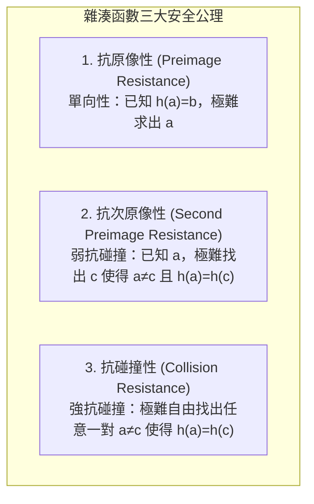

# 密碼學數學困難問題公理 (Cryptographic Hard Problems & Assumptions)

## 1. 核心概念與理論地位
現代公鑰密碼學與身分協議（AKA / AKE）的安全性，本質上均建立在計算複雜度理論 (Computational Complexity Theory) 之特定**單向單陷阱數學難題 (One-Way Trapdoor Hard Problems)** 之上。若演算法在機率多項式時間 (Probabilistic Polynomial Time, PPT) 內無法破解該難題，則該密碼協議被視為在計算上是安全的。

---

## 2. 密碼學雜湊函數三大特性公理 (Hash Function Assumptions)

設單向抗碰撞雜湊函數 $h: A \rightarrow B$：

### 數學公理定義 [Lecture_09, Slide 16]：
1. **抗原像性 (Preimage Resistance / One-Way)**：
   $$\forall b \in B, \quad \Pr[h(a) = b] \le \epsilon \quad (\text{極難由雜湊值反推原像 } a)$$
2. **抗次原像性 (Second Preimage Resistance / Weak Collision Resistance)**：
   $$\forall a \in A, \quad \Pr[a \ne c \land h(a) = h(c)] \le \epsilon \quad (\text{固定某一明文，極難找到另一明文具相同雜湊})$$
3. **抗碰撞性 (Collision Resistance / Strong Collision Resistance)**：
   $$\Pr[\exists a, c \in A : a \ne c \land h(a) = h(c)] \le \epsilon \quad (\text{任意選擇兩個不同明文，極難使其雜湊相同})$$

> **生日悖論定理 (Birthday Paradox)**：
> 輸出為 $n$-bit 的雜湊函數，破解抗原像性需要 $2^n$ 次嘗試；但破解抗碰撞性僅需約 $2^{n/2}$ 次嘗試！因此雜湊函數的抗碰撞安全強度以其輸出一半長度計算（如 SHA-256 之抗碰撞強度為 128-bit）。

---

## 3. 離散對數與 Diffie-Hellman 困難問題家族 (DL, CDH, DDH)

令 $G$ 為乘法循環群，階數為大質數 $q$，$g$ 為群 $G$ 之生成元 (Generator) [Lecture_09, Slide 18]：

| 困難問題名稱 | 縮寫 | 給定已知條件 | 欲求解之目標 | 難度層級 |
| :--- | :---: | :--- | :--- | :---: |
| **離散對數問題** (Discrete Logarithm) | **DL** | 給定 $g, q$ 與 $y = g^a \bmod q$ | 求指數 $a$ | 最高難度 |
| **計算型 DH 問題** (Computational Diffie-Hellman) | **CDH** | 給定 $g^a \bmod q$ 與 $g^b \bmod q$（$a, b$ 未知） | 求 $g^{ab} \bmod q$ | 介於中間 |
| **判定型 DH 問題** (Decisional Diffie-Hellman) | **DDH** | 給定 $g^a, g^b, g^c \bmod q$（$a, b, c$ 未知） | 判定 $g^c \stackrel{?}{=} g^{ab} \bmod q$ | 相對較易 |

- **難度包含關係 (Reduction)**：
  $$\text{DL is hard} \impliedby \text{CDH is hard} \impliedby \text{DDH is hard}$$
  若能輕易解出 DL，則必能輕易解出 CDH 與 DDH；反之不成立。

---

## 4. 橢圓曲線密碼困難問題家族 (ECDL, ECCDH, ECDDH)

令 $E$ 為定義在有限體 $\mathbb{F}_q$ 上之橢圓曲線，$P$ 為加法循環群 $G_1$ 之生成元（階數為大質數 $q$）[Lecture_09, Slide 20-21]：

| 困難問題名稱 | 縮寫 | 給定已知條件 | 欲求解之目標 |
| :--- | :---: | :--- | :--- |
| **橢圓曲線離散對數問題** | **ECDL** | 給定基點 $P$ 與點 $Q = dP \in G_1$ | 求整數純量 $d$ (Private Key) |
| **橢圓曲線計算型 DH** | **ECCDH** | 給定基點 $P$、點 $aP$、點 $bP$（$a, b$ 未知） | 求點 $abP \in G_1$ (Shared Secret) |
| **橢圓曲線判定型 DH** | **ECDDH** | 給定基點 $P$、點 $aP, bP, cP$ | 判定 $cP \stackrel{?}{=} abP$ |

- **ECC 優勢本質**：傳統有限體 DL 存在次指數時間解法（指數微積分法 Index Calculus），而橢圓曲線 ECDL 僅有全指數時間解法（Pollard's Rho 演算法，複雜度 $\mathcal{O}(\sqrt{q})$）。因此 ECC 能以大幅縮短之金鑰長度達到相同安全級別（ECC 256-bit 安全強度相當於 RSA/DH 3072-bit）。

---

## 5. 雙線性配對困難問題 (Bilinear Pairing: BDH, DBDH)

設映射 $\hat{e}: G_1 \times G_1 \rightarrow G_2$，滿足三項基本公理 [Lecture_09, Slide 23]：
1. **雙線性 (Bilinear)**：$\hat{e}(aQ, bR) = \hat{e}(Q, R)^{ab}, \quad \forall a, b \in \mathbb{Z}_q^*, \; Q, R \in G_1$。
2. **非退化性 (Non-degenerate)**：存在 $Q, R \in G_1$ 使得 $\hat{e}(Q, R) \ne 1$。
3. **可計算性 (Computable)**：存在多項式時間演算法可有效計算 $\hat{e}(Q, R)$。

### 核心配對難題：
- **雙線性 Diffie-Hellman 問題 (BDH)**：給定 $P, aP, bP, cP \in G_1$，求 $\hat{e}(P, P)^{abc} \in G_2$。
- **判定型雙線性 Diffie-Hellman 問題 (DBDH)**：給定 $P, aP, bP, cP \in G_1$ 與 $T \in G_2$，判定 $T \stackrel{?}{=} \hat{e}(P, P)^{abc}$。
- **應用場景**：雙線性配對為**三方一輪金鑰協議 (Tripartite AKE)**、**身分型加密 (IBE)**、**屬性型加密 (ABE)** 與**短簽章 (BLS Signature)** 的底層數學核心。

---

## 6. 證照高頻考點與易混淆陷阱 (Exam Focus)

- **考點 1：弱抗碰撞 vs. 強抗碰撞之差異**
  - **Weak (Second Preimage)**：目標明文 $M$ 是固定的，攻擊者需找到另一個 $M'$ 使 $H(M) = H(M')$。
  - **Strong (Collision)**：攻擊者自由發揮，只要能找到任意兩組不同明文其雜湊相同即算破解。
- **考點 2：Diffie-Hellman 的中間人攻擊脆弱性**
  - 單純的 DH 協議只保證金鑰協議 (Key Agreement)，**不提供身分鑑別 (Authentication)**！攻擊者可分別與 Alice、Bob 完成 DH 交換，完全掌控通訊。因此現代系統必須採用 **AKE (Authenticated Key Exchange)**。
- **考點 3：量子計算對數學難題的毀滅性衝擊**
  - 上述所有基於質因數分解 (IFP)、離散對數 (DL)、橢圓曲線離散對數 (ECDL) 的傳統難題，均被量子計算的 **Shor 演算法在多項式時間內徹底攻破**！詳閱 [[wiki/concepts/advanced_encryption_and_pqc]]。

---

## 7. 出處依據與關聯鏈結
- **來源依據**：[Lecture_09_Crypto, Slide 15-24]
- **關聯頁面**：
  - [[wiki/concepts/cia_triad]]
  - [[wiki/concepts/advanced_encryption_and_pqc]]
  - [[wiki/syntheses/symmetric_vs_asymmetric_cryptography]]
  - [[wiki/cert_prep/cissp_domain_3_cryptography]]
