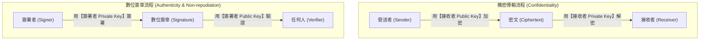
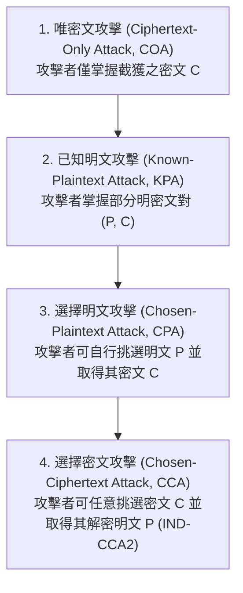

# 對稱式 vs. 非對稱式密碼學與密文攻擊綜合評比矩陣

本評比矩陣對比對稱式密碼 (Symmetric Cryptography) 與非對稱式公鑰密碼 (Asymmetric Cryptography) 的數學原理、金鑰分發成本、效能差異、安全屬性，並結構化梳理密碼分析的四大攻擊模式階梯。

---

## 1. 對稱式 vs. 非對稱式全維度對比矩陣 (Core Comparison Matrix)

| 評比維度 | 對稱式密碼系統 (Symmetric / Secret-Key) | 非對稱式密碼系統 (Asymmetric / Public-Key) | 混合式密碼系統 (Hybrid Cryptosystem) |
| :--- | :--- | :--- | :--- |
| **金鑰本質** | 單一共享密鑰 (Shared Secret Key) | 數學關聯之公私鑰對 (Public Key & Private Key) | 結合兩者優勢（實務 TLS/HTTPS 標準做法） |
| **數學理論基礎** | 代換-置換網路 (SPN)、費斯妥架構 (Feistel Network)、混淆 (Confusion) 與擴散 (Diffusion) | 單向陷門函數、數學困難問題（大數分解、離散對數 DL、橢圓曲線 ECDL、晶格難題） | 公鑰演算法用於身分驗證與協商對稱金鑰；對稱演算法用於資料本體傳輸 |
| **代表性演算法** | AES, 3DES, ChaCha20, RC4 | RSA, ECC (ECDH/ECDSA), Diffie-Hellman, ElGamal, PQC (Kyber/Dilithium) | TLS 1.3, IPsec, PGP/GPG, SSH |
| **運算速度與資源消耗** | **極快**（硬體指令集加速，高吞吐量，適合 GB/TB 大規模資料傳輸） | **慢**（需要龐大模數冪次或群運算，比對稱加密慢 100~1000 倍） | 兼具公鑰之金鑰分發便利性與對稱式之極致傳輸效能 |
| **金鑰數量成長公式** | 隨使用者人數 $N$ 呈平方級暴增： $$\text{Keys} = \frac{N(N-1)}{2} = \mathcal{O}(N^2)$$ | 隨使用者人數 $N$ 呈線性成長： $$\text{Keys} = 2N = \mathcal{O}(N)$$ | 伺服器僅需一組憑證，客戶端每次動態協商 |
| **金鑰分發難題** | 必須依賴安全帶外管道 (Out-of-band) 事先共享金鑰，面臨「先有雞還是先有蛋」矛盾 | 公鑰可完全公開揭露，私鑰由本地妥善保管；僅需解決公鑰真實性 (CA/PKI) | 透過 DH/ECDH 解決金鑰交換難題 |
| **核心安全功能** | **機密性 (C)**、搭配 MAC 提供**完整性 (I)** | **機密性 (C)**、**身分真實性 (A)**、**不可否認性 (Non-repudiation)** | 全面滿足 CIA + Authenticity + Non-repudiation |
| **能否提供數位簽章** | **絕對不能**（兩端共享金鑰，無法抗賴） | **可以**（私鑰簽章，公鑰驗證） | 可以 |
| **抗量子計算衝擊** | **輕微影響**（Grover 演算法平方根加速，金鑰長度加倍至 256-bit 即可維持安全） | **毀滅性打擊**（Shor 演算法於多項式時間破解 RSA/ECC，必須遷移至 PQC） | 對稱通道安全，金鑰交換需升級為 PQC KEM |

---

## 2. 加解密 vs. 數位簽章對稱鏡像操作表 (Slide 33)

這是 CISSP 與資訊安全考試中最常考的邏輯對稱題型：

| 比較項目 | 機密性傳輸 (Encryption) | 數位簽章 (Digital Signature) |
| :--- | :--- | :--- |
| **核心安全目的** | 傳送機密訊息給特定接收者 (Confidentiality) | 證明簽署者身分與內容未遭竄改 (Authenticity, Integrity & Non-repudiation) |
| **加密/簽署運算使用的金鑰** | **接收者之公鑰 (Receiver's Public Key)** | **發送者/簽署者之私鑰 (Signer's Private Key)** |
| **解密/驗證運算使用的金鑰** | **接收者之私鑰 (Receiver's Private Key)** | **發送者/簽署者之公鑰 (Signer's Public Key)** |
| **誰能夠執行操作？** | **任何人**都可以拿公鑰加密 | **只有簽署者本人**能簽出有效簽章 |
| **誰能夠驗證/讀取？** | **只有持有私鑰之接收者**解得開 | **任何人**只要取得公鑰皆可驗證 |
| **安全哲學本質** | **非接收者本人解不開** | **非簽署者本人簽不出來** |

---

## 3. 密碼破譯與密文攻擊模式四大階梯 (Cryptanalytic Attack Models)

依據攻擊者掌握的資訊資源多寡，密碼分析攻擊強度由弱至強分為四個階梯 [Lecture_09, Slide 27-28]：

1. **唯密文攻擊 (Ciphertext-Only Attack, COA)**：
   - 掌握條件：僅截獲未知明文的密文串。
   - 破譯手段：依賴統計分析、頻率分析、熵值檢驗。現代對稱與非對稱密碼必須保證能抵禦 COA。
2. **已知明文攻擊 (Known-Plaintext Attack, KPA)**：
   - 掌握條件：攻擊者擁有幾組已知的明文與其對應的密文（例如已知檔案開頭一定是特定 PDF 或 HTTP 標頭）。
   - 歷史範例：二戰圖靈破解 Enigma 機（利用德軍每日氣象廣播固定的開頭用語 "WETTER" 進行破譯）。
3. **選擇明文攻擊 (Chosen-Plaintext Attack, CPA)**：
   - 掌握條件：攻擊者可向加密機送入任意明文 $P_i$，並獲得其對應的密文 $C_i$。
   - 安全目標：密碼演算法必須具備 **IND-CPA (不可區分性選擇明文安全)**，這意味著加密演算法必須是**機率性 (Probabilistic) 加密**，每次加密相同明文必須加入隨機性 IV/Padding（如 RSA-OAEP）。
4. **選擇密文攻擊 (Chosen-Ciphertext Attack, CCA / CCA2)**：
   - 掌握條件：攻擊者可存取解密預言機 (Decryption Oracle)，送入任意密文 $C_j$ 並獲取其解密後的明文（除目標挑戰密文 $C^*$ 本身之外）。
   - 安全目標：**IND-CCA2 (適應性選擇密文安全)** 是公鑰加密機制的最高安全黃金標準，可防範 Bleichenbacher 填充預言機攻擊 (Padding Oracle Attack)。

---

## 4. 證照高頻考點與易混淆陷阱 (Exam Focus)

- **考點 1：金鑰對數計算題**
  - 若組織有 1,000 名員工，採用對稱加密需幾把金鑰？
    $$\frac{1000 \times 999}{2} = 499,500 \text{ 把金鑰}$$
  - 若改採公鑰非對稱架構，只需幾把金鑰？
    $$2 \times 1000 = 2,000 \text{ 把金鑰（1000 對公私鑰）}$$
- **考點 2：一次性密碼本 (One-Time Pad, OTP) 為何稱作完美保密 (Perfect Secrecy)？**
  - 條件：金鑰真隨機、長度等於明文、金鑰僅使用一次不重複。香農證明在這些條件下，$P(M|C) = P(M)$，攻擊者即使擁有無限算力也無法獲得任何資訊。
- **考點 3：電子錢包 Address 與金鑰之關係**
  - 比特幣帳戶 Address 係由 Public Key 經過 SHA-256 與 RIPEMD-160 雜湊計算後生成；進行轉帳交易時由 Private Key 進行數位簽章。

---

## 5. 出處依據與關聯鏈結
- **來源依據**：[Lecture_09_Crypto, Slide 26-39]
- **關聯頁面**：
  - [[wiki/concepts/cia_triad]]
  - [[wiki/models/cryptographic_hard_problems]]
  - [[wiki/concepts/advanced_encryption_and_pqc]]
  - [[wiki/cert_prep/cissp_domain_3_cryptography]]
