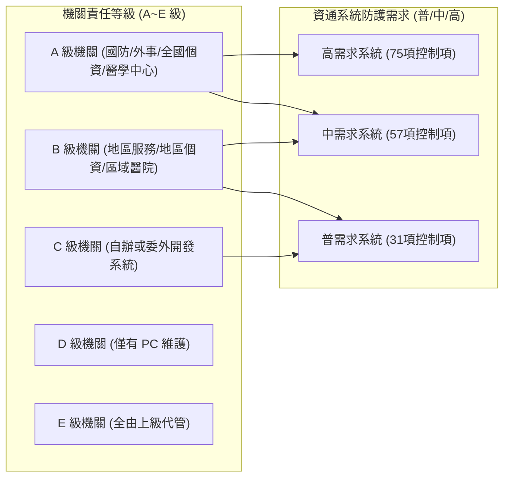

# 台灣資訊安全與數位法規治理體系總對照矩陣

本評比矩陣橫向整合我國資安長 (CISO)、資安法遵長及 CISSP 考生必須掌握的五大核心法規體系，釐清立法意旨、保護法益、責任歸屬與罰則邊界。

---

## 1. 五大法規體系橫向評比矩陣 (Cross-Regulatory Comparison Matrix)

| 維度 / 法規 | 《個人資料保護法》 (PDPA) | 《刑法》第 36 章妨害電腦使用罪 | 《營業秘密法》 (Trade Secrets Act) | 智慧財產權體系 (著作權法/專利法) | 《資通安全管理法》 (CSMA) |
| :--- | :--- | :--- | :--- | :--- | :--- |
| **主要保護法益** | 人格權、隱私權、資訊自主權 | 電腦系統運作之可用性、完整性與機密性 | 企業無形競爭優勢與商業機密 | 人類精神創作 (著作權) / 產業技術進步 (專利權) | **國家安全、公共利益、關鍵基礎設施與社會秩序** |
| **核心規範對象** | 自然人、法人、非法人團體、公務機關 | 任何無故破壞電腦或竊取電磁紀錄之行為人 | 取得、使用或洩漏他人營業秘密之人 | 著作利用人、發明人與專利實施人 | **公務機關、CI 提供者、公營事業、政府捐助財團法人** |
| **防護或成立要件** | • 蒐集/處理/利用法定要件 • 技術與組織安全維護措施 (TOMs) | • 「無故」輸入密碼/破解防護 • 「無故」取得/刪除/變更電磁紀錄 • 「無故」干擾運作 | **法定三要件**： 1. 秘密性 2. 經濟價值 3. **合理保密措施** (Reasonable Efforts) | • 著作權：原創性、獨立創作、非觀念保護 • 專利權：產業利用性、新穎性、進步性 (需申請公開) | 依責任等級 (A~E 級) 導入 ISMS、防護基準、通報應變與情資分享 |
| **法律責任性質** | 民事損害賠償、行政罰鍰、刑事責任 (意圖營利) | **純刑事責任** (告訴乃論，但公務電腦非告訴乃論) | 民事懲罰性賠償 (最高 3 倍)、刑事責任 (域外使用加重) | 民事損害賠償、刑事責任 (侵害著作權)、專利侵權純民事 | **行政責任為主** (限期改正、行政罰鍰、公務人員考績獎懲) |
| **主管機關** | 個人資料保護委員會 (籌備處) | 法務部 / 檢察與司法機關 | 經濟部智慧財產局 / 智慧財產法院 | 經濟部智慧財產局 | **數位發展部 (資通安全署)** |
| **重大資安違規後果** | 罰鍰最高 1500 萬元 (重大非公務機關洩漏) | 最重處 5 年有期徒刑；若毀損國防公務電腦加重至 1/2 | 境內最重 5 年，**意圖域外使用最重處 10 年有期徒刑**並科 5000 萬元罰金 | 著作權最重 3~5 年徒刑；專利權僅民事賠償無刑責 | 命限期改善，逾期處 10 萬~100 萬元罰鍰；公務員移付懲戒 |

---

## 2. 責任等級體系與資通系統防護基準對照

我國《資通安全管理法》建立在「**機關分級 (A~E 級)**」與「**資通系統防護需求分級 (普/中/高)**」的雙軌矩陣架構之上：

### 關鍵治理連鎖機制
1. **機關責任等級決定組織資源配置**：決定需編制多少專職人員（A 級 4 人、B 級 2 人、C 級 1 人）、外部驗證週期（3 年內通過第三方驗證）與健診頻率。
2. **系統防護需求決定技術控制深淺**：核心系統進行 C, I, A 鑑價後取最大值，若達「高需求」，則強制落實源碼掃描 (SAST)、滲透測試 (Pen-Test)、多重認證 (MFA) 與靜置資料加密。

---

## 3. CISSP 考點縱向映射表 (CISSP Domain Mapping)

| 台灣本土法規與規範 | CISSP 知識體系 (CBK) 對應章節 | 關鍵考點概念與英文對照 |
| :--- | :--- | :--- |
| **資通安全管理法 (CSMA)** | Domain 1: Security Governance & Legal Regulations | Regulatory Compliance, Governance Structure, CISO Roles |
| **關鍵基礎設施 (CI) 8 大領域** | Domain 1: Critical Infrastructure Protection | Sector-Specific Frameworks, Public-Private Partnership |
| **維護計畫與詳細風險評鑑** | Domain 1: Risk Assessment & Management | Risk Identification, Asset Valuation ($\max(C,I,A)$), Risk Calculation ($A \times T \times V$), Risk Treatment Strategies |
| **個人資料保護法 (PDPA)** | Domain 1: Privacy & Data Protection Regulations | Data Subject Rights, Data Controller vs. Processor, Privacy Notice |
| **刑法第 36 章 (妨害電腦使用)** | Domain 1: Computer Crimes & Intellectual Property Laws | Unauthorized Access, Denial of Service, Malware Distribution |
| **營業秘密法 (合理保密措施)** | Domain 1: Trade Secrets & Intellectual Property | Trade Secret vs. Patent, Due Diligence, Reasonable Steps to Protect Confidentiality |
| **資安事件通報 (1hr / 36hr / 72hr)** | Domain 7: Incident Management & Disaster Recovery | Incident Response Life Cycle, MTD/RTO/RPO, Mandatory Breach Notification |
| **N-ISAC / TLP 分享協定** | Domain 7: Threat Intelligence & Information Sharing | Cyber Threat Intelligence (CTI), Traffic Light Protocol (TLP Red/Amber/Green/White), IoC/IoA |

---

## 4. 出處依據與關聯鏈結
- **整合依據**：
  - [[wiki/frameworks/taiwan_pdpa]]
  - [[wiki/frameworks/gdpr]]
  - [[wiki/frameworks/taiwan_cybercrime_law]]
  - [[wiki/frameworks/trade_secret_act]]
  - [[wiki/frameworks/taiwan_cybersecurity_management_act]]
  - [[wiki/frameworks/taiwan_cybersecurity_responsibility_tiers]]
  - [[wiki/frameworks/cybersecurity_maintenance_plan_and_risk_assessment]]
  - [[wiki/concepts/incident_response_and_reporting]]
  - [[wiki/concepts/threat_intelligence_sharing_and_tlp]]
  - [[wiki/cert_prep/cissp_domain_1_legal_regulations]]
